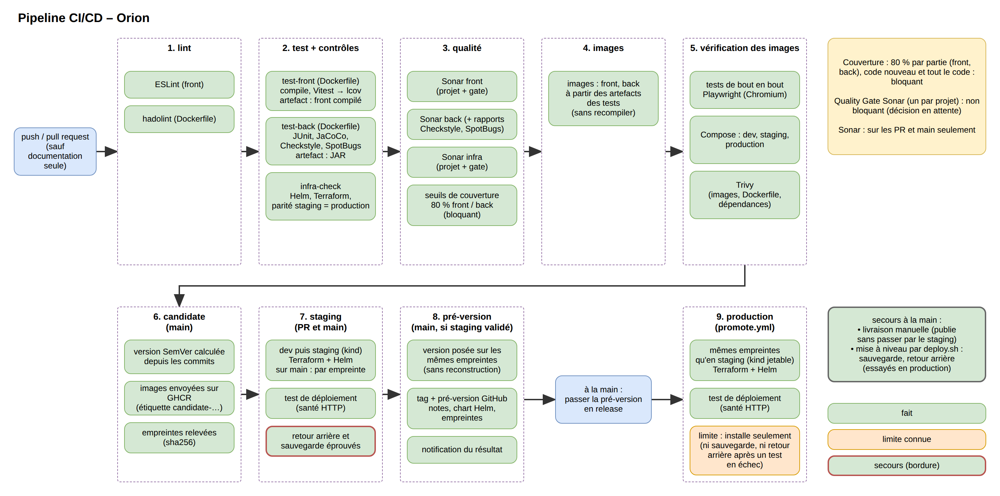

<p align="center">
   
</p>

# MicroCRM (P5 - Expert DevOps - Gérez le cycle de vie de développement logiciel)

MicroCRM est une application de démonstration basique ayant pour être objectif de servir de socle pour le module "P5 - Expert DevOps".

L'application MicroCRM est une implémentation simplifiée d'un ["CRM" (Customer Relationship Management)](https://fr.wikipedia.org/wiki/Gestion_de_la_relation_client). Les fonctionnalités sont limitées à la création, édition et la visualisations des individus liés à des organisations.


> L'API n'a **pas d'authentification** : ne pas l'exposer sur Internet (cf. [`docs/SECURITE.md`](./docs/SECURITE.md)).

## Code source

### Organisation

Ce [monorepo](https://en.wikipedia.org/wiki/Monorepo) contient :

| Dossier | Contenu |
|---|---|
| `back/` | serveur : Java 21, Spring Boot 4.1, Spring Data REST, Gradle |
| `front/` | client : Angular 22, tests Vitest |
| `e2e/` | tests de bout en bout (Playwright) |
| `Dockerfile`, `misc/docker/` | images `front` et `back` |
| `deploy/` | Docker Compose, chart Helm, Terraform |
| `scripts/` | tests de déploiement, déploiement, secours, release, qualité |
| `.github/workflows/` | pipeline CI/CD (GitHub Actions) |
| `docs/` | déploiement, sécurité, tests, livrables, backlog |
| `learning/` | fiches et flashcards |

Le fichier [`.gitlab-ci.yml`](./.gitlab-ci.yml) d'origine est conservé pour mémoire ; il n'est plus maintenu (ses
options de test du front datent de Karma). Le pipeline en service est celui de GitHub Actions.

Les scripts sont dans `scripts/`. Ils s'arrêtent à la première erreur et sortent en code 2 quand les arguments
sont faux. L'en-tête de chaque fichier détaille son fonctionnement, ses options et ses variables.

### Prérequis

| Pour | Outils du poste |
|---|---|
| lancer l'application et les tests | Docker (avec Compose et BuildKit), `curl` |
| développer avec rechargement à chaud | [JDK 21](https://openjdk.org/), [Node.js 24](https://nodejs.org/) |
| Kubernetes sur le poste | minikube, `kubectl`, Helm (la CI utilise la 4), Python 3 ; Terraform 1.17 pour la démonstration Terraform |
| rejouer toute la CI | les mêmes, plus Git |

## Utiliser l'application

**Complète, avec Docker seul** (le plus simple) :

```shell
scripts/app.sh start                 # construit et démarre : http://localhost:4280 (API sur le port 8080)
scripts/app.sh logs
scripts/app.sh stop
scripts/app.sh start staging         # comme la production : https://localhost:4443, données conservées
```

**Avec des réglages** (ports, un seul des deux services, HTTPS, données) :

```shell
scripts/run_all.sh --front-port 5000 --back-port 5001 --build      # arrêt : scripts/run_all.sh --stop
scripts/run_back.sh --port 9090                                    # back seul
scripts/run_front.sh --api-url http://localhost:9090               # front seul : http://localhost:4280
```

| Script | Options principales |
|---|---|
| `run_all.sh` | `--front-port` (4280), `--back-port` (8080), `--https`, `--data VOLUME`, `--bind`, `--name`, `--build`, `--stop` |
| `run_back.sh` | `--port` (8080), `--cors`, `--data VOLUME`, `--env`, `--bind`, `--name`, `--image`, `--build`, `--stop` |
| `run_front.sh` | `--port` (4280), `--https`, `--api-url` ou `--upstream`, `--env`, `--bind`, `--name`, `--image`, `--build`, `--stop` |

Une image absente est construite ; `--build` la reconstruit après un changement de code. Les ports n'écoutent que sur
le poste (`127.0.0.1`) sauf `--bind` : l'API n'a pas d'authentification. `run_back.sh` et `run_front.sh` passent à
`docker run` ce qui suit `--` (ex. `-- --memory 1g`). Avec un front lancé seul sur un autre port que 4280, déclarer
son origine au back (`run_back.sh --cors http://localhost:<port>`).

**Pour développer, avec rechargement à chaud** :

```shell
scripts/deps.sh install              # dépendances verrouillées du front et du back
cd back && ./gradlew bootRun          # http://localhost:8080 (Windows : gradlew.bat bootRun)
cd front && npm start                 # http://localhost:4200, dans un autre terminal
```

## Utiliser l'infrastructure

**Docker Compose**, pour les trois environnements : `scripts/compose.sh <dev|staging|production> <commande compose>`
(la production prend les ports 80 et 443).

**Kubernetes avec Helm, sur minikube** :

```shell
minikube start
scripts/install-dev.sh               # première installation (ou install-staging.sh)
scripts/helm-deploy.sh status dev
scripts/helm-deploy.sh open dev      # http://localhost:8080, Ctrl+C pour arrêter
scripts/upgrade-dev.sh               # après un changement de code
scripts/helm-deploy.sh uninstall dev
```

Ces scripts ne visent que minikube. La mise à niveau passe par `deploy.sh` : sauvegarde (en staging), test de
déploiement et retour arrière en cas d'échec. Secours à la main : `scripts/rollback.sh microcrm-staging`,
`scripts/backup.sh microcrm-staging`, `CONFIRM=oui scripts/restore.sh <archive> microcrm-staging`. Après
`uninstall` en staging, le volume de données est conservé.

**Terraform** (dev puis staging créés, vérifiés et détruits, secours compris) :
`scripts/ci_local.sh test-front test-back images staging` (ou `images staging` : le Dockerfile compile). Autres clusters et détails : [`docs/DEPLOIEMENT.md`](./docs/DEPLOIEMENT.md).

## Tester la CI à la main

**Un job rejouable porte le nom de son script** : le job `compose-test` de la CI lance `scripts/ci/compose-test.sh`,
et `scripts/ci_local.sh compose-test` lance le même.

| Job et script de `scripts/ci/` | Contrôle | Après |
|---|---|---|
| `lint` | hadolint, ESLint | – |
| `test-front`, `test-back` | tests dans l'étape de compilation (back : avec Checkstyle et SpotBugs) | – |
| `coverage` | tests des scripts, seuils de couverture | les deux tests |
| `infra-check` | Helm, parité, ShellCheck, Terraform | – |
| `images` | images front et back | – |
| `compose-test` | déploiement des trois environnements | `images` |
| `e2e` | parcours dans un navigateur | `images` |
| `scan` | Trivy sur le dépôt et les images | `images` |
| `staging` | dev et staging avec Terraform, secours compris | `images` ; minikube |

`sonar-*`, `candidate`, `release` et `notify` dépendent de GitHub et ne se rejouent pas. Les contrôles s'écrivent
dans les scripts, pas dans `ci.yml`, qui ne décrit que les déclencheurs, les outils, les artefacts et les droits.

**Sur le poste**, avant de pousser :

```shell
scripts/ci_local.sh all                               # tous les jobs rejouables sauf staging
scripts/ci_local.sh test-front test-back coverage     # ou seulement certains jobs
scripts/ci_local.sh images e2e
scripts/ci_local.sh images staging                    # sur minikube
```

Les outils manquants sont signalés avant de commencer. `images` reprend les produits des tests si `test-front` et
`test-back` font partie de la même commande ; sinon le Dockerfile compile, pour ne jamais tester un ancien produit. Les ports de Compose
doivent être libres. Ni Sonar ni la publication ne sont rejoués.

**Sur GitHub**, sur la branche choisie, sans PR et sans rien publier (le staging est joué, pas les analyses Sonar) :

```shell
gh workflow run ci.yml --ref <branche>     # ou onglet Actions, « Run workflow »
gh run watch
```

Chaque script de `scripts/ci/` se lance aussi seul. `ci_test.sh <front|back>` et `build_images.sh [artifacts]` sont
les outils qu'ils appellent. Autres commandes de test : [`docs/TESTS.md`](./docs/TESTS.md).

## Référence des scripts

| Script | But | Paramètres |
|---|---|---|
| `app.sh` | application complète (Compose) | `start\|stop\|status\|logs [dev\|staging]` |
| `run_all.sh`, `run_back.sh`, `run_front.sh` | conteneurs avec réglages (`lib_run.sh`) | voir ci-dessus |
| `compose.sh` | Compose par environnement | `<env> <commande compose>` |
| `helm-deploy.sh` | Helm sur minikube (`lib_minikube.sh`) | `install\|upgrade\|status\|open\|uninstall <dev\|staging>` ; `SKIP_BUILD`, `LOCAL_PORT` |
| `install-*.sh`, `upgrade-*.sh` | raccourcis de `helm-deploy.sh` | aucun |
| `ci_local.sh` | rejouer la CI | `all` ou noms de jobs |
| `ci/<job>.sh` | ce que fait le job de même nom (`lib_ci.sh`) | aucun ; variables en tête de fichier |
| `ci_test.sh` | tests dans l'étape de compilation, produit extrait | `<front\|back>` |
| `build_images.sh` | images front et back | `[dossier des artefacts]` ; `IMAGE_TAG` |
| `deps.sh` | dépendances : installation verrouillée, verrous, retards | `install\|lock\|outdated [front\|back\|all]` |
| `lint_scripts.sh` | ShellCheck (image épinglée) | aucun |
| `check_parity.sh` | staging identique à la production | aucun |
| `deploy.sh` | déployer une version : sauvegarde, Helm, test, retour arrière | `<env> <version> [options helm]` |
| `deploy_demo.sh` | démonstration CD avec Terraform | `<version> [préfixe]` ; `KUBE_CONTEXT` |
| `verify_deployment.sh`, `smoke_test.sh` | test de déploiement | `<espace de noms>` ; `<URL>` |
| `rollback.sh` | retour arrière puis vérification | `<espace> [release] [révision]` |
| `backup.sh`, `restore.sh` | sauvegarde, restauration (`lib_volume.sh`) | `<espace>` ; `<archive> <espace>`, `CONFIRM=oui` |
| `test_recovery.sh` | éprouver les secours (environnement de test) | `<env> <version> [options helm]` |
| `trivy.sh` | scan de sécurité | `repo` ou `image <nom>…` |
| `e2e.sh` | tests de bout en bout (Playwright) | `[URL]` |
| `candidate_images.sh`, `publish_images.sh` | livraison sur GHCR | voir l'en-tête |
| `release.py`, `coverage_gate.py` | version et notes ; seuils de couverture | `--base <ref>`, `--blocking` |
| `notify.sh` | notification | `<success\|failure> <message>` |
| `sonar-export.sh`, `sonar-export-release.sh` | clichés qualité dans `docs/quality/` | `-p front\|back\|infra` ; `<tag>` |
| `build-livrables.sh` | livrables au format Word | aucun |

## Pipeline CI/CD



À chaque push qui touche autre chose que la documentation (`**.md`, `docs/`, `learning/`) : lint, tests, couverture, analyses, construction et test des images, scan de sécurité. Sur les PR et
`main`, dev et staging sont déployés sur un cluster jetable. Sur `main`, quand les commits le justifient et que le
staging est validé, une **pré-version** est publiée (images sur GHCR, release GitHub). La passer au statut de
release déploie en production les mêmes images, désignées par leur empreinte. La promotion sait installer la production, pas encore la mettre à
niveau (pour cela : `scripts/deploy.sh`). Détail : [`docs/DEPLOIEMENT.md`](./docs/DEPLOIEMENT.md).

## Images Docker

`docker build --target front -t microcrm-front:local .` (de même avec `back`). À la main, le Dockerfile compile
lui-même ; en CI, les images reprennent les produits des jobs de tests.
