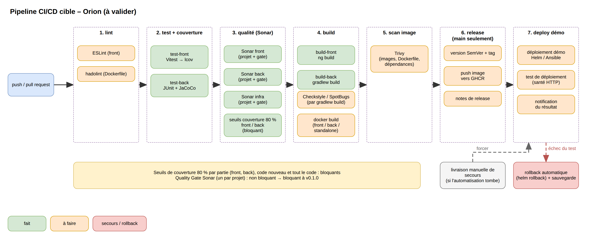

# 1. Introduction

## 1.1 Objectifs

Définir des règles communes (code, versions, revue, CI, tests, sécurité, documentation) pour que chaque
livraison de l'application Full-Stack d'Orion soit **automatisée, répétable et vérifiée**, puis planifier la
mise en œuvre de la chaîne CI. Les équipes Dev et Ops appliquent les mêmes règles et lisent les mêmes
résultats.

## 1.2 Contexte

Voir le document de veille et d'audit (Modèle 1). Résumé : application au deuxième sprint ; CI limitée à tests
et build ; analyse de sécurité faite par les Ops après livraison ; déploiement manuel ; Dev peu expérimentés en
Java. L'état initial (tag `v0.0.1`) comptait 90 vulnérabilités npm dont 5 critiques, 35 issues SonarQube
(6 vulnérabilités) et une couverture de 37,1 %.

## 1.3 État initial du pipeline (description)

Pipeline d'origine (`.gitlab-ci.yml`), 2 stages et 4 jobs :

| Stage | Job | Image | Contenu |
|---|---|---|---|
| test | test-front | `cypress/browsers:latest` | `npm ci`, tests Karma en Chrome headless |
| test | test-back | `gradle:jdk17` | `./gradlew test` |
| build | build-front | `node` (latest) | `npm ci`, `ng build --optimization` |
| build | build-back | `gradle:jdk17` | `./gradlew build` |

Défauts : images non versionnées (`latest`), aucune analyse (sécurité, statique, lint), aucune image
produite ni publiée, aucun déploiement, aucune notification, aucune mesure.

# 2. Normes et bonnes pratiques

## 2.1 Principes de base

- **Automatisation** : toute opération répétée devient un job ou un script versionné.
- **Répétabilité** : versions et digests épinglés ; verrous (`package-lock.json`, `gradle.lockfile`).
- **Sécurité au plus tôt (shift-left)** : les contrôles tournent côté Dev, avant la livraison aux Ops.
- **Qualité** : pas de fusion sans CI verte ; couverture et Quality Gate suivis.
- **Justification** : tout choix technique est motivé dans un commentaire ou un message de commit.

## 2.2 Conventions d'écriture de code et règles de style

| Zone | Règle | Outil de contrôle |
|---|---|---|
| Front (Angular / TypeScript) | Guide de style Angular ; pas de promesse non gérée ; champs de formulaire avec label | ESLint (`angular-eslint`), SonarQube |
| Back (Java 21 / Spring Boot) | Conventions Java usuelles, couches contrôleur / service / dépôt, pas de logique dans les contrôleurs | Checkstyle, SpotBugs, SonarQube |
| Dockerfile | Mot-clé `AS` en majuscules, un stage par cible, utilisateur non root | hadolint, SonarQube |
| Scripts | Bash : `set -euo pipefail`, ShellCheck ; Python : tests `pytest` | ShellCheck, pytest |
| Commits | Conventional commits (`feat:`, `fix:`, `ci:`, `docs:`, `build:`) | contrôle en revue |

## 2.3 Gestion des versions

- **Modèle de branches** : GitHub Flow / trunk-based. Une branche `main` toujours livrable et des branches
  courtes. Choix justifié par la petite équipe (6 personnes), la fréquence de livraison souhaitée et
  l'absence de plusieurs versions maintenues en parallèle.
- **Nommage** : `front/…`, `back/…`, `ci/…`, `docs/…`, `fix/…`, selon le périmètre.
- **Fusion** : par pull request, en **rebase** pour garder un historique linéaire ; la branche est supprimée.
- **Versionnement** : Semantic Versioning (`MAJEUR.MINEUR.CORRECTIF`) ; tags `vX.Y.Z` ; génération
  automatisée à terme à partir des conventional commits.
- **Épinglage** : images de base et actions CI par version **et** digest/SHA, version en commentaire ;
  versions LTS dont le support dépasse 05/2027 ; Dependabot hebdomadaire.

## 2.4 Revue de code

- Toute modification passe par une pull request. **Au moins 1 approbation** d'un autre membre de l'équipe
  (un Ops relit les changements d'infrastructure, un Dev relit le code applicatif).
- Critères d'acceptation : CI verte, Quality Gate SonarQube vert, pas de CVE critique ou haute corrigeable,
  tests ajoutés pour tout correctif (un test qui échoue sans le correctif).
- La PR n'est ouverte que lorsque la CI de la branche est verte.
- Protection de `main` : pas de push direct, pas de fusion si un contrôle obligatoire échoue.

## 2.5 Intégration continue

- Déclenchement : à chaque push de branche et à chaque pull request.
- Fréquence d'intégration : au moins une PR par jour de travail sur une fonctionnalité ; branches de moins de
  quelques jours.
- Critère de réussite : tous les jobs obligatoires verts (lint, tests, build, scans).
- Outil : GitHub Actions (workflow validé), dans la continuité des projets précédents : environnement cohérent
  GitHub, GitHub Actions, GHCR (voir 3.5, risque R2 pour le lien GitLab attendu par le sujet).
- Ordre des jobs : lint, puis tests avec couverture, puis, en parallèle, les trois analyses SonarQube (une par
  projet : front, back et infra, voir 2.6) et le contrôle des seuils de couverture (job `coverage`), puis build,
  scan de l'image, release et déploiement. SonarQube vient après les tests car il importe leur couverture (les
  rapports des tests sont réutilisés, sans relancer les tests) ; le build attend les analyses pour ne pas
  construire une version dont l'analyse a échoué. L'analyse de l'infra n'attend rien et part dès le début.
- Lint : le job `lint` ne contient qu'**ESLint** et **hadolint**. **Checkstyle** et **SpotBugs** sont lancés par
  `./gradlew build` dans le job `build-back`, après la compilation dont ils ont besoin. Conséquence acceptée :
  leurs erreurs n'apparaissent qu'à l'étape de build, et ce job relance les tests du back.
- Durée de référence : **127 s** au tag `v0.0.2` (Sonar en parallèle des tests, sans cache). Avec un seul scan
  Sonar entre les tests et le build : **181 s** sur `main` (run 45809708667, scan de 104 s). Avec trois scans
  parallèles : **131 s** sur `main` (run 45880516355), le plus long scan (back) durant 62 s.

## 2.6 Tests

| Type | Outil | Déclenchement | Cible |
|---|---|---|---|
| Unitaires back | JUnit (Gradle) | chaque push | couverture du code nouveau ≥ 80 % |
| Unitaires front | Vitest (via `ng test`, DOM simulé jsdom, sans navigateur) | chaque push | couverture du code nouveau ≥ 80 % |
| Intégration back | Spring Boot Test | chaque push | endpoints principaux |
| Scripts d'automatisation | pytest, Bash Unit, ShellCheck | chaque push | chaque script testé |
| Sécurité | SonarQube, Trivy | PR, `main`, hebdomadaire | 0 vulnérabilité critique/haute |
| Déploiement | script de test de déploiement (santé HTTP) | après déploiement | application répond |

**Seuils de couverture par partie (décidé le 26/11/2026).** Le front et le back ont chacun leurs seuils, pour
qu'une partie ne masque pas l'autre dans une moyenne : **80 %** sur **tout le code** et **80 %** sur le **code
nouveau** (lignes ajoutées ou modifiées par rapport à la branche visée), soit quatre taux. Ils sont vérifiés par
un job de CI dédié (`coverage`, script `scripts/coverage_gate.py`, avec ses propres tests), qui lit les rapports
des jobs de tests (lcov pour le front, JaCoCo pour le back) et applique la même formule que SonarQube (lignes et
branches).

- **Mode actuel : bloquant** depuis le 26/11/2026. Un taux sous le seuil fait échouer le job et empêche les
  builds. Le passage a été fait par une PR dédiée, une fois les 80 % dépassés sur tout le code des deux parties :
  front 97,5 %, back 93,9 %. Les quatre taux sont concernés ; sans ligne nouvelle à couvrir, le taux sur le code
  nouveau n'est pas un échec.
- **Un projet et un Quality Gate Sonar par partie (fait le 26/11/2026).** SonarQube Cloud applique un gate par
  projet ; le dépôt a donc trois projets Sonar (support des monorepos, [documentation
  Sonar](https://docs.sonarsource.com/sonarqube-cloud/analyzing-source-code/monorepo-support)) : `front`, `back`
  et `infra` (Dockerfile, workflows GitHub Actions, scripts). Chacun a son gate, ses notes et son périmètre
  (un `sonar-project.properties` par dossier de base), et son propre scan en parallèle. L'infra ne mesure pas de
  couverture : ce sont des outils, pas l'application. Les gates restent ceux par défaut de Sonar, sur le code
  nouveau (approche « Clean as You Code », [documentation
  Sonar](https://docs.sonarsource.com/sonarcloud/improving/clean-as-you-code)), et **non bloquants**. Le job
  `coverage` reste en plus : il contrôle les 80 % sur tout le code et sur le code nouveau, ce que le gate par
  défaut de Sonar ne fait pas (il ne porte que sur le code nouveau).

Les tests de bout en bout et de performance seront ajoutés avec la partie 2 (déploiement, charge).

## 2.7 Sécurité

- **SAST** : SonarQube à chaque PR et sur `main`.
- **Dépendances et images** : Trivy (dépendances, Dockerfile, images) ; scan hebdomadaire planifié.
- **Secrets** : stockés dans les secrets de la plateforme CI (jamais dans le dépôt) ; jeton SonarQube en
  secret ; détection de secrets par Trivy.
- **Images** : épinglées, exécutées sans root, construites avec `npm ci --ignore-scripts`.
- **Droits** : jetons de CI au moindre privilège.
- **Gestion des vulnérabilités** : critique = correction avant fusion ; haute = correction sous 7 jours ;
  moyenne et basse = traitement planifié dans le backlog.

## 2.8 Documentation

- README technique à jour : configuration, tests, déploiement du pipeline ; but, fonctionnement et paramètres de
  chaque script.
- `docs/BACKLOG.md` et `docs/SESSION.md` : tâches et état courant.
- `docs/quality/` : clichés SonarQube par jalon (`v0.0.1`, `v0.0.2`, …).
- Documentation CI/CD complète : template fourni, complété au fil des étapes.

# 3. Plan de mise en œuvre

## 3.1 Objectifs

Obtenir une chaîne CI/CD qui, à chaque PR : vérifie (lint, tests, SonarQube, Trivy), construit les images,
les publie et les déploie sur l'environnement de démonstration, avec notification du résultat et possibilité de
déclencher manuellement une livraison en cas de panne de l'automatisation.

## 3.2 Étapes

### 3.2.1 Étape 1 : Pipeline CI de base

- **Description** : tests et build du front et du back, images et actions épinglées, Node 24 et Java 21.
- **Responsables** : Dev (lead : Roubina).
- **Livrables** : workflow CI fonctionnel ; mesure de durée de référence.
- **État** : **fait** (GitHub Actions).

### 3.2.2 Étape 2 : Contrôles qualité et sécurité

- **Description** : SonarQube avec couverture (un projet et un gate par partie, non bloquants) et seuils de couverture par partie (job `coverage`, bloquant), Trivy (dépendances, Dockerfile, images), lint
  (ESLint, hadolint), Checkstyle et SpotBugs dans le build Gradle.
- **Responsables** : Dev, avec Ops pour les seuils Trivy.
- **Livrables** : jobs `lint`, `trivy`, `sonar-front`, `sonar-back`, `sonar-infra` ; rapport des résultats ; seuils documentés.
- **État** : SonarQube **fait**, en trois projets (front, back, infra) depuis le 26/11/2026, gates non
  bloquants ; seuils de couverture
  par partie **faits** (bloquants depuis le 26/11/2026) ; Trivy et lint **à faire**.

### 3.2.3 Étape 3 : Scripts d'automatisation

- **Description** : scripts Bash/Python pour la gestion des dépendances, l'exécution des tests, le
  déploiement, la sauvegarde et la notification des résultats ; tests des scripts (ShellCheck, pytest).
- **Responsables** : Ops (Bash, Ansible) avec un Dev pour Python.
- **Livrables** : dossier `scripts/` documenté dans le README (but, fonctionnement, paramètres).

### 3.2.4 Étape 4 : Livraison automatisée de l'image

- **Description** : publication des images dans un registre, versionnement SemVer automatique, livraison
  manuelle de secours.
- **Responsables** : Dev et Ops.
- **Livrables** : images dans le registre ; tag de version ; notes de release.

### 3.2.5 Étape 5 : Déploiement automatisé

- **Description** : déploiement sur l'environnement de démonstration (Docker, puis Kubernetes + Helm, puis
  Terraform + Ansible, cf. partie 2) ; test de déploiement ; procédure de rollback ; sauvegarde.
- **Responsables** : Ops.
- **Livrables** : charts Helm, fichiers Terraform, playbooks Ansible, pipeline CD.

## 3.3 Ressources nécessaires

| Ressource | Détail |
|---|---|
| Personnel | 4 Dev, 2 Ops (un DevOps pour la mise en place) |
| Plateforme CI | GitHub Actions (continuité des projets précédents) ; lien GitLab du sujet : voir risque R2 |
| Qualité | SonarQube Cloud (compte et jeton), Trivy (open source) |
| Registre | GHCR (registre de la plateforme CI) ; Harbor et Nexus écartés (runners hébergés, voir Modèle 1 §2.3.3) |
| Environnement | environnement de démonstration ; local : Docker, Minikube |
| Budget | principalement du temps ; services gratuits (Free Tier) |

## 3.4 Calendrier prévisionnel

Dans un fonctionnement normal (ressources disponibles, sans blocage).

| Semaine | Étape | Résultat attendu |
|---|---|---|
| S1 : 23–27/11/2026 | Étape 2 (Trivy, lint, Sonar non bloquant), début Étape 3 | jobs de contrôle verts sur PR |
| S2 : 30/11–04/12/2026 | Étape 3 (scripts), Étape 4 (registre, image livrée) | image publiée à chaque fusion |
| S3 : 07–11/12/2026 | Étape 4 (versionnement), début Étape 5 | version générée automatiquement |
| S4–S5 : 14–25/12/2026 | Étape 5 (déploiement, rollback, sauvegarde) | déploiement automatisé, rollback testé |
| Jalon `v0.1.0` | Quality Gate bloquant | gate vert sur `main` |

## 3.5 Gestion des risques

| # | Risque | Probabilité | Mesure d'atténuation |
|---|---|---|---|
| R1 | Équipe Dev peu expérimentée en Java : sous-estimation des corrections | Haute | Sonar non bloquant d'abord ; revue systématique ; formation courte ; pair programming avec un Ops/senior |
| R2 | Le sujet évoque un lien GitLab public alors que le choix assumé est GitHub (dépôt, Actions, GHCR) | Moyenne | Faire confirmer par le mentor que le dépôt GitHub public est accepté ; sinon, miroir GitLab avec un `.gitlab-ci.yml` équivalent |
| R3 | Couverture de tests faible (37,1 %) : Quality Gate difficile à tenir | Moyenne | Seuils de 80 % par partie, sur le **code nouveau** et sur tout le code, **bloquants** depuis qu'ils sont atteints (front 97,5 %, back 93,9 % au 26/11) ; ajout de tests à chaque correctif |
| R4 | Faux positifs Trivy qui bloquent la CI | Moyenne | Fichier d'exceptions justifiées (`.trivyignore`) ; bloquer seulement les CVE corrigeables |
| R5 | Panne de l'automatisation lors d'une livraison urgente | Moyenne | Livraison manuelle de secours documentée |
| R6 | Dépendance à un service externe (Sonar, registre) | Moyenne | Jetons en secrets ; image conservée comme artefact de la CI ; livraison manuelle de secours ; mesure de disponibilité |
| R7 | Savoir de sécurité concentré chez 2 Ops | Moyenne | Partage via la CI et la documentation ; relecture croisée |

# 4. Conclusion

## 4.1 Synthèse

La normalisation fixe des règles uniques de code, de versions, de revue, de tests et de sécurité, et les fait
appliquer par la CI. Elle transforme un processus manuel (contrôle des CVE par les Ops après livraison) en un
processus automatisé, répétable et mesurable.

## 4.2 Prochaines étapes

- Terminer les étapes 2 et 3 du plan (Trivy, lint, scripts) ; passer le Quality Gate en mode bloquant.
- Compléter la documentation CI/CD : stratégie de tests, schémas d'architecture IaC, plan de sécurité,
  plans de release, de rollback et de sauvegarde.
- Mettre en œuvre la partie 2 : Docker, Kubernetes, Helm, Terraform, Ansible, monitoring, métriques DORA.
- Réviser ce document à chaque jalon.

# Annexe : schéma du pipeline cible

Vert : fait ; orange : à faire ; rouge : secours et rollback. Source modifiable : `schema_pipeline_ci_cd.drawio`.

{width=9.4in}
