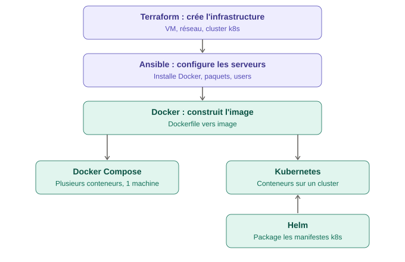
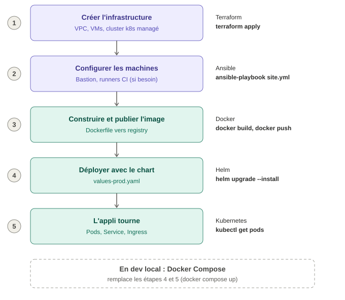

# Pense-bête DevOps : Terraform, Ansible, Docker, Compose, Kubernetes, Helm

Six outils qu'on cite ensemble sans toujours savoir qui fait quoi. La clé est de les ranger par
**question à laquelle ils répondent** : quelle infrastructure créer (Terraform), comment configurer les
machines (Ansible), comment empaqueter l'application (Docker), comment la lancer (Compose ou
Kubernetes), comment réutiliser et paramétrer ces déploiements (Helm). Cette fiche donne l'ordre
d'enchaînement, un tableau de référence et un cas concret de bout en bout.

## La chaîne d'outils

{width=85%}

Violet : infrastructure (machines, réseau). Vert : conteneurs et orchestration.

- **Terraform** et **Ansible** préparent le terrain. Terraform crée les machines, le réseau ou le
  cluster. Ansible configure l'intérieur des machines.
- **Docker** produit l'image. **Compose** et **Kubernetes** (k8s) la lancent : Compose sur une seule
  machine (dev, petit serveur), Kubernetes sur un cluster (prod, haute disponibilité).
- **Helm** n'existe que dans l'univers Kubernetes : c'est un emballage et un système de templates
  autour des manifestes YAML (YAML Ain't Markup Language). Il n'a aucun lien avec Compose.

## Tableau récapitulatif

| Outil | Question à laquelle il répond | Fichier | Commande clé |
|---|---|---|---|
| **Terraform** | Quelle infra cloud faut-il créer ? | `main.tf` | `terraform apply` |
| **Ansible** | Comment configurer ces machines ? | `playbook.yml` | `ansible-playbook` |
| **Docker** | Comment empaqueter mon appli ? | `Dockerfile` | `docker build`, `docker run` |
| **Compose** | Comment lancer app + base sur 1 machine ? | `compose.yaml` | `docker compose up` |
| **Kubernetes** | Comment la faire tourner en prod, à l'échelle ? | manifestes YAML | `kubectl apply` |
| **Helm** | Comment réutiliser et paramétrer ces manifestes ? | `Chart.yaml`, `values.yaml` | `helm install` |

Cinq verbes pour ne pas se tromper :

| Verbe | Sens | Outil |
|---|---|---|
| Provisionner | créer des ressources | Terraform |
| Configurer | régler l'état d'une machine | Ansible |
| Empaqueter | fabriquer une image | Docker |
| Orchestrer | lancer, surveiller, remplacer des conteneurs | Compose, Kubernetes |
| Templater | générer des manifestes depuis des valeurs | Helm |

### Deux chevauchements qui prêtent à confusion

- **Terraform peut aussi déployer dans k8s** : ses providers `helm` et `kubernetes` permettent de
  créer le cluster, puis d'y installer des releases Helm.
- **Ansible peut tout lancer** : il sait appeler Docker, Compose ou `kubectl`. On l'utilise alors
  comme simple script d'orchestration, pas pour ce qu'il fait de mieux (configurer des machines).

### Ce qui est déclaratif

Terraform, Compose, Kubernetes et Helm décrivent un **état désiré** dans des fichiers ; l'outil
calcule l'écart avec la réalité et le comble. Terraform garde en plus un fichier d'état (*state*)
pour savoir ce qu'il a déjà créé. Ansible décrit aussi un état (tâches idempotentes : relancer un
playbook ne change rien si la machine est déjà conforme) et agit par SSH, sans agent installé.

## Cas concret : de zéro à l'appli en prod

{width=85%}

| Étape | Produit |
|---|---|
| 1. Terraform | un cluster vide, joignable via `~/.kube/config` (kubeconfig) |
| 2. Ansible | des machines annexes prêtes (facultatif avec un cluster managé) |
| 3. Docker | une image versionnée dans un registry |
| 4. Helm | des manifestes générés à partir des values, envoyés à l'API Kubernetes |
| 5. Kubernetes | l'état désiré réalisé : réplicas, réseau, redémarrages automatiques |

En dev local, `docker compose up` remplace les étapes 4 et 5 : même image, un seul fichier, une
seule machine.

## Dans Orion

Le dépôt utilise cinq de ces six outils. **Ansible** n'est pas utilisé : il n'y a aucune machine à configurer,
le déploiement visant un cluster Kubernetes.

| Outil | Dans le dépôt | Rôle |
|---|---|---|
| Docker | [`Dockerfile`](../../Dockerfile), deux images, `front` et `back` | images non root, bases épinglées par digest |
| Compose | [`deploy/compose/`](../../deploy/compose/) | dev, staging, production sur une machine |
| Helm | [`deploy/helm/microcrm/`](../../deploy/helm/microcrm/) | chart avec des valeurs par environnement |
| Kubernetes | cluster kind jetable dans la CI | déploiement de démonstration |
| Terraform | [`deploy/terraform/`](../../deploy/terraform/README.md) | espace de noms, quotas, release Helm |

Un conteneur par service : Compose et Kubernetes les lancent et les relient.

Pour aller plus loin : [processus CI/CD](processus-ci-cd.md), [conteneurs](conteneurs-orion.md),
[Kubernetes, Helm, Terraform](kubernetes-helm-terraform-orion.md).

## À retenir

1. Un outil, une question : Terraform crée l'infra, Ansible configure les machines, Docker empaquette,
   Compose ou Kubernetes lancent, Helm paramètre les manifestes k8s.
2. Compose = une machine ; Kubernetes = un cluster. Helm ne sert qu'avec Kubernetes.
3. Terraform et Ansible préparent le terrain **avant** les conteneurs ; Docker, Compose, Kubernetes et
   Helm s'occupent de l'application elle-même.
4. Les chevauchements existent (providers Terraform `helm` et `kubernetes`, Ansible qui lance `kubectl`),
   mais chaque outil garde son rôle principal.
5. Dans Orion, Docker, Compose, Helm, Kubernetes et Terraform sont en place ; Ansible n'est pas utilisé.
